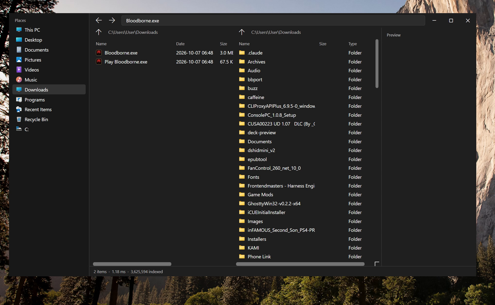

# WSearch

Whole-disk file search for Windows. Fuzzy names, typo tolerance, indexed
content grep. Same query language as
[fsearch](https://github.com/noahdunnagan/fsearch) on macOS.

NTFS is crawled from **`$MFT`** (sequential I/O). macOS has no equivalent:
fsearch tree-walks with `getattrlistbulk`. Changes stream from the **USN
journal**. The exe requests Administrator on launch so `\\.\C:` opens.



[Demo (mp4)](demo/demo.mp4) — Win11 dark theme, Places sidebar, dual panes,
preview. Search `Bloodborne.exe` over 3.6M files in **1.18 ms**.


```
cargo build --release
dotnet build ui/WSearch.Ui.csproj -c Release
.\target\release\wsearch.exe install --startup
wsearch                          # WPF dual-pane browser
wsearch main.rs                  # CLI
wsearch 'ext:rs grep:apply_dir'
```

## Native UI

`wsearch` with no args opens a WPF browser (WinExe, no console flash) in the
same spirit as [OneCommander](https://www.onecommander.com/):

- Win11 **dark / light** follows the system theme
- Places sidebar (This PC, Desktop, Documents, Recycle Bin, drives)
- Dual panes + preview, custom caption chrome
- Full-bleed Fluent icon (taskbar plate, not a padded squircle)
- Search box uses the same fuzzy / `ext:` / `mtime:` language as the CLI
- Footer shows hit count and engine time in milliseconds
- Shell context menu; Delete goes to Recycle Bin

| | |
|---|---|
| Search | Ctrl+F, type to filter; This PC or current folder |
| Open | Enter / double-click |
| Navigate | Alt+Left/Right, Alt+Up, sidebar |
| Files | Del, F5 |
| Context | Open, Show in Explorer, Copy path |
| Classic | `wsearch win32` for the Common Controls listview |

Recents is `mtime:<30d`. The UI is `ui/WSearch.Ui` (.NET 8 WPF). `install`
copies it next to `wsearch.exe` and pins Start / Desktop shortcuts.
Without the WPF build, the Win32 browser still launches.


## Speed

fsearch numbers are from their README (M4 Max, 7.7M files). wsearch numbers
were measured on this Windows box, 3.6M files, Ryzen-class NVMe, release
build.

| | fsearch (macOS) | wsearch (Windows) |
|---|---|---|
| Name search, warm | p50 **1.3 ms** (7.7M) | p50 **0.18 ms** (3.6M) |
| Name search, first query after load | — | **3.5 ms** |
| First crawl | **~20 s** tree walk (`getattrlistbulk`) | **$MFT** sequential (needs admin). Without admin: directory walk, **56 s** for 3.6M |
| Live updates | FSEvents (~0.1 s) | USN journal |
| Index | mmap names, interned | same layout |

Warm name search is already faster here. The crawl gap vs Mac is the MFT:
one sequential pass over the catalog, not one syscall per folder.

Without elevation Windows refuses `\\.\C:`, so the first run shows a UAC
prompt. Decline it and wsearch still works; it just walks directories.

## vs fsearch

Same ideas (interned names, folder-range `in:`, unique-name scoring, trigram
content index, typo-1 on 5+ letter words). Windows-native pieces:

- `$MFT` instead of `getattrlistbulk`
- USN journal instead of FSEvents
- named pipe `\\.\pipe\wsearch-ipc` instead of a unix socket
- `NtQueryDirectoryFile` + worker pool when MFT is unavailable

## Queries

```
wsearch 'readme in:C:\Users\you\src'
wsearch 'type:image size:>5mb mtime:<7d'
wsearch 'ext:rs regex:fn\s+\w+_dir'
wsearch 'sym:apply_dir'
wsearch 'drive:C ext:rs main'
```

Words are fuzzy. 5+ letter words forgive one typo (`mian.rs` finds
`main.rs`). Also `'exact`, `^prefix`, `suffix$` and `!exclude`. Filters:
`ext:` `type:` `kind:` `in:` `drive:` `size:` `mtime:` `re:` `path:`
`grep:` `regex:` `sym:` `limit:`. Content search is smart-case.

## Daemon

JSON lines over `\\.\pipe\wsearch-ipc`, or `wsearch stdio`:

```json
{"q": "wsearch main", "limit": 20}
{"op": "grep", "pattern": "apply_dir", "in": "C:\\Users\\you\\src"}
```

Index files live in `%LOCALAPPDATA%\wsearch` (`WSEARCH_DIR` overrides).

`wsearch install --startup` copies the binary and WPF UI to
`%LOCALAPPDATA%\wsearch` and adds a HKCU Run key (still needs the UAC grant).

## How it works

- NTFS: parse `$MFT` file records (names, parents, size, mtime, attributes)
  then stay current from the USN journal. A journal wrap rebuilds.
- Non-NTFS / UAC declined: parallel `NtQueryDirectoryFile` (256 KB buffers,
  fixed worker pool). Live updates via `ReadDirectoryChangesW`.
- Names live in one mmap'd file, laid out folder by folder so `in:` is a
  range. Each distinct name is scored once. The map is prefetched so the
  first query is not a page-fault storm.
- Content search uses a trigram index of your text files. Matches are
  read fresh from disk.
